<div align="center">
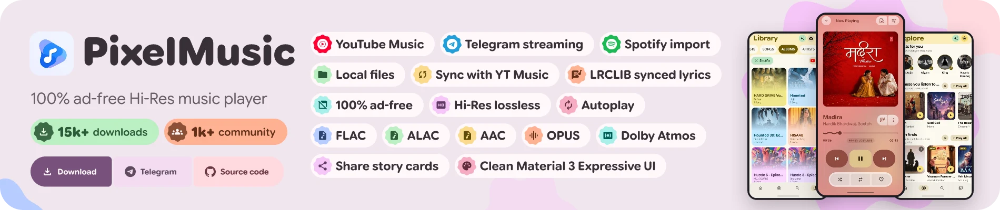
<br><br>

<p align="center">
  <a href="https://trendshift.io/repositories/181534" target="_blank" rel="noopener noreferrer">
    
  </a>
</p>

<p align="center">
<a href="https://github.com/ianshulyadav/PixelMusic/releases"><picture><source media="(prefers-color-scheme: dark)" srcset="assets/readme/dark/btn-download.svg"></picture></a>
<a href="https://t.me/pixelmusicapp"><picture><source media="(prefers-color-scheme: dark)" srcset="assets/readme/dark/btn-telegram.svg"></picture></a>
<a href="https://github.com/ianshulyadav/PixelMusic"><picture><source media="(prefers-color-scheme: dark)" srcset="assets/readme/dark/btn-github.svg"></picture></a>
<a href="#support"><picture><source media="(prefers-color-scheme: dark)" srcset="assets/readme/dark/btn-donate.svg"></picture></a>
</p>

<p align="center">
<picture><source media="(prefers-color-scheme: dark)" srcset="assets/readme/dark/badge-adfree.svg"></picture>
<picture><source media="(prefers-color-scheme: dark)" srcset="assets/readme/dark/badge-lossless.svg"></picture>
<picture><source media="(prefers-color-scheme: dark)" srcset="assets/readme/dark/badge-ytsync.svg"></picture>
<picture><source media="(prefers-color-scheme: dark)" srcset="assets/readme/dark/badge-m3e.svg"></picture>
<picture><source media="(prefers-color-scheme: dark)" srcset="assets/readme/dark/badge-android.svg"></picture>
<picture><source media="(prefers-color-scheme: dark)" srcset="assets/readme/dark/badge-gpl.svg"></picture>
</p>

</div>

PixelMusic is an open-source Android music player that plays music from multiple sources in one place. You can listen to files stored on your device, stream from YouTube Music, play audio from your Telegram channels and chats, or build smart playlists using AI within the same app.

It supports high-resolution local audio formats including FLAC, ALAC, WAV, APE, and MP3. The interface automatically picks its color scheme from the album art of the track that is currently playing. There are no ads and no subscriptions.

<h3 id="screenshots"><picture><source media="(prefers-color-scheme: dark) and (max-width: 640px)" srcset="assets/readme/dark/hm-screenshots.svg"><source media="(prefers-color-scheme: dark)" srcset="assets/readme/dark/h-screenshots.svg"><source media="(max-width: 640px)" srcset="assets/readme/light/hm-screenshots.svg"></picture></h3>

<div align="center">
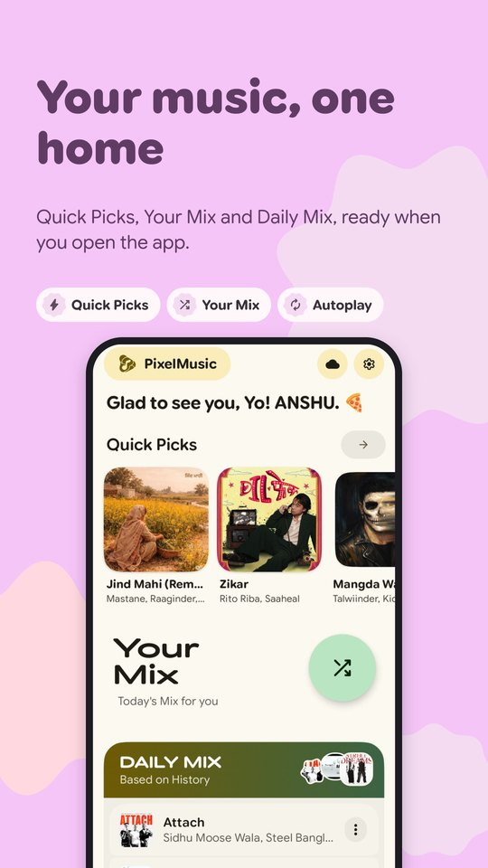
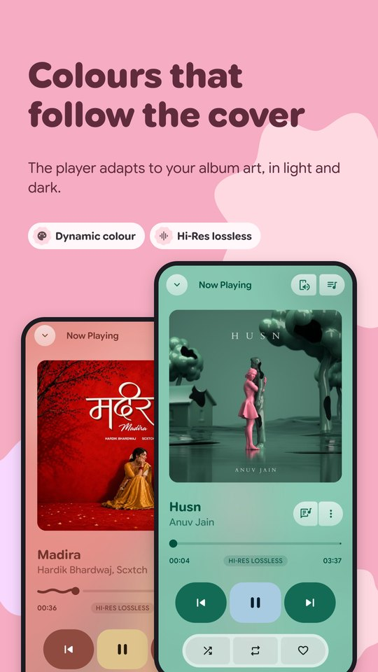
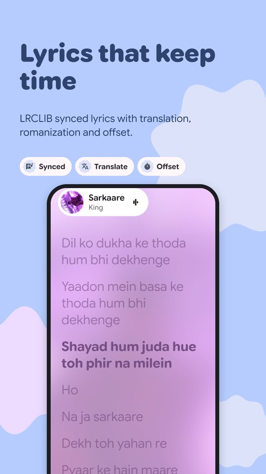
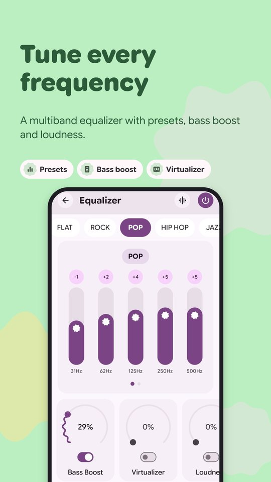
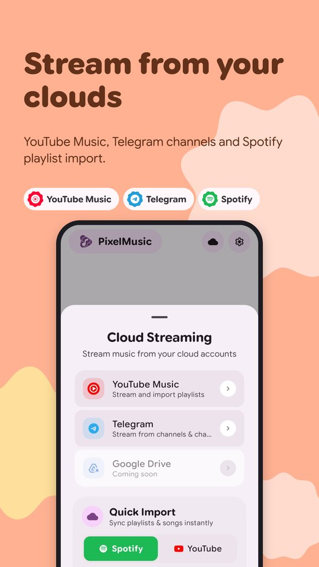
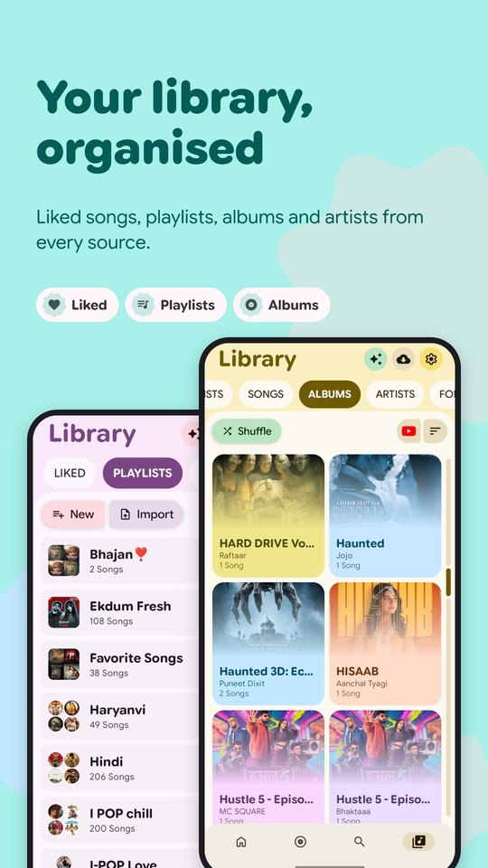
</div>

<h3 id="features"><picture><source media="(prefers-color-scheme: dark) and (max-width: 640px)" srcset="assets/readme/dark/hm-features.svg"><source media="(prefers-color-scheme: dark)" srcset="assets/readme/dark/h-features.svg"><source media="(max-width: 640px)" srcset="assets/readme/light/hm-features.svg"></picture></h3>

<details>
<summary><b>Technical Specifications & Capabilities (Expand)</b></summary>

- **Audio Formats**: Bit-perfect Hi-Res FLAC, ALAC, WAV, APE (up to 24-bit/192kHz), plus AAC, OPUS, OGG, MP3.
- **Audio Processing**: Media3 ExoPlayer with FFmpeg extension, 10-band EQ, Bass Boost, ReplayGain/EBU R128 loudness normalization, gapless playback, and 0–15s crossfade.
- **Sources**: Local offline files, YouTube Music (search, stream, library sync), Telegram audio channels/chats, Spotify & YouTube playlist import.
- **Lyrics**: LRCLIB synchronized lyrics with millisecond offset adjustment, offline caching, live translation, and phonetic romanization (Pinyin, Romaji, Hangul).
- **Integrations**: Android Auto (MediaLibraryService), Chromecast / Google Cast, Wear OS companion app, Last.fm & ListenBrainz scrobbling.
- **Design & UI**: 100% Kotlin, Jetpack Compose, Material 3 Expressive, dynamic color palettes from album artwork and system wallpapers.
- **AI Features**: Smart playlist generator via natural language prompts (supporting Gemini, DeepSeek, OpenAI).
- **License & Requirements**: 100% free, no ads, open-source under GNU GPL v3.0. Requires Android 11 (API 30) or above.

</details>

<div align="center">

<picture><source media="(prefers-color-scheme: dark)" srcset="assets/readme/dark/card-audio.svg">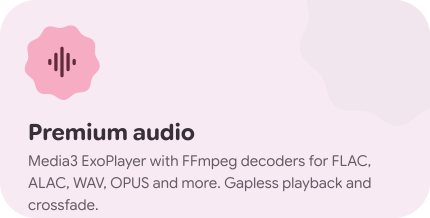</picture>
<picture><source media="(prefers-color-scheme: dark)" srcset="assets/readme/dark/card-streaming.svg">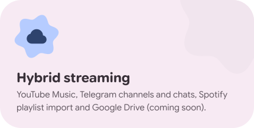</picture>
<picture><source media="(prefers-color-scheme: dark)" srcset="assets/readme/dark/card-lyrics.svg">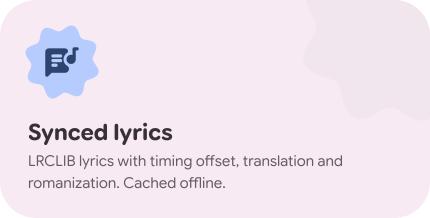</picture>
<picture><source media="(prefers-color-scheme: dark)" srcset="assets/readme/dark/card-eq.svg">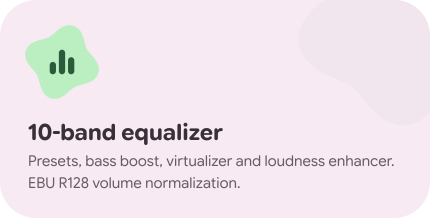</picture>
<picture><source media="(prefers-color-scheme: dark)" srcset="assets/readme/dark/card-ai.svg">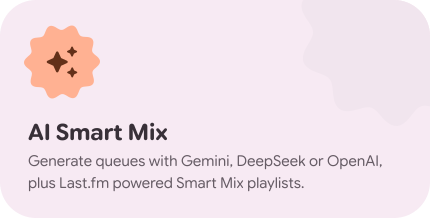</picture>
<picture><source media="(prefers-color-scheme: dark)" srcset="assets/readme/dark/card-theme.svg">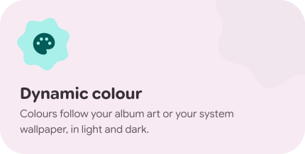</picture>

</div>

<h3 id="start"><picture><source media="(prefers-color-scheme: dark) and (max-width: 640px)" srcset="assets/readme/dark/hm-start.svg"><source media="(prefers-color-scheme: dark)" srcset="assets/readme/dark/h-start.svg"><source media="(max-width: 640px)" srcset="assets/readme/light/hm-start.svg"></picture></h3>

```bash
git clone https://github.com/ianshulyadav/PixelMusic.git
cd PixelMusic
./gradlew :app:assembleDebug
```

<h3 id="support"><picture><source media="(prefers-color-scheme: dark) and (max-width: 640px)" srcset="assets/readme/dark/hm-support.svg"><source media="(prefers-color-scheme: dark)" srcset="assets/readme/dark/h-support.svg"><source media="(max-width: 640px)" srcset="assets/readme/light/hm-support.svg"></picture></h3>

<div align="center">

<a href="https://ko-fi.com/H2K222J1ME" target="_blank"><picture><source media="(prefers-color-scheme: dark)" srcset="assets/readme/dark/btn-kofi.svg"></picture></a>
<a href="upi://pay?pa=anshulyadavv@fam&pn=PixelMusic&cu=INR"><picture><source media="(prefers-color-scheme: dark)" srcset="assets/readme/dark/btn-upi.svg"></picture></a>

</div>

<br>

## CREDITS

Special thanks to **[InnerTube](https://github.com/vfsfitvnm/ViMusic)**, **[ArchiveTune](https://github.com/ArchiveTune)**, and **[ViMusic](https://github.com/vfsfitvnm/ViMusic)**.

Search terms: Pixel Music, PixelMusic, Android music player, ad-free music player, open-source music player, Hi-Res lossless player, FLAC player, ALAC player, YouTube Music client, Telegram music player, LRCLIB lyrics, Material 3 Expressive.

PixelMusic is licensed under the **GNU General Public License v3.0**. Portions are based on [PixelPlayerOSS](https://github.com/PixelPlayerHQ/PixelPlayerOSS) by [Theo Vilardo](https://github.com/theovilardo) and Duhan Yağmur Delikkulak. Not affiliated with or endorsed by the upstream project. Upstream notice kept in [`LICENSE`](LICENSE) and [`PROVENANCE.md`](docs/PROVENANCE.md).
