<div align="center">

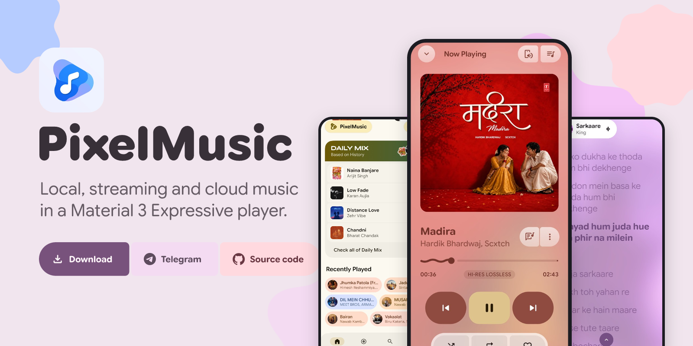

<br>

<p align="center">
<a href="https://github.com/ianshulyadav/PixelMusicApp/releases"><picture><source media="(prefers-color-scheme: dark)" srcset="assets/readme/dark/btn-download.svg"></picture></a>
<a href="https://t.me/pixelmusicapp"><picture><source media="(prefers-color-scheme: dark)" srcset="assets/readme/dark/btn-telegram.svg"></picture></a>
<a href="https://github.com/ianshulyadav/PixelMusicApp"><picture><source media="(prefers-color-scheme: dark)" srcset="assets/readme/dark/btn-github.svg"></picture></a>
<a href="#support"><picture><source media="(prefers-color-scheme: dark)" srcset="assets/readme/dark/btn-donate.svg"></picture></a>
</p>

<p align="center">
<picture><source media="(prefers-color-scheme: dark)" srcset="assets/readme/dark/badge-adfree.svg"></picture>
<picture><source media="(prefers-color-scheme: dark)" srcset="assets/readme/dark/badge-lossless.svg"></picture>
<picture><source media="(prefers-color-scheme: dark)" srcset="assets/readme/dark/badge-formats.svg"></picture>
<picture><source media="(prefers-color-scheme: dark)" srcset="assets/readme/dark/badge-ytsync.svg"></picture>
<picture><source media="(prefers-color-scheme: dark)" srcset="assets/readme/dark/badge-m3e.svg"></picture>
<picture><source media="(prefers-color-scheme: dark)" srcset="assets/readme/dark/badge-android.svg"></picture>
<picture><source media="(prefers-color-scheme: dark)" srcset="assets/readme/dark/badge-kotlin.svg"></picture>
<picture><source media="(prefers-color-scheme: dark)" srcset="assets/readme/dark/badge-gpl.svg"></picture>
<picture><source media="(prefers-color-scheme: dark)" srcset="assets/readme/dark/badge-prs.svg"></picture>
</p>

</div>


<h3 id="overview"><picture><source media="(prefers-color-scheme: dark) and (max-width: 640px)" srcset="assets/readme/dark/hm-overview.svg"><source media="(prefers-color-scheme: dark)" srcset="assets/readme/dark/h-overview.svg"><source media="(max-width: 640px)" srcset="assets/readme/light/hm-overview.svg"></picture></h3>

PixelMusic is an open-source Android music player that plays music from multiple sources in one place. You can listen to files stored on your device, stream from YouTube Music, play audio from your Telegram channels and chats, or build smart playlists using AI within the same app.

It supports high-resolution local audio formats including FLAC, ALAC, WAV, APE, and MP3. The interface automatically picks its color scheme from the album art of the track that is currently playing. There are no ads and no subscriptions.

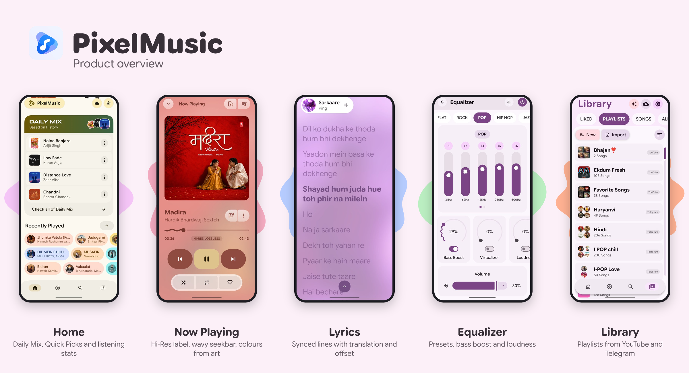

<table width="100%"><thead><tr><th align="left" width="28%">Quick facts</th><th align="left">Details</th></tr></thead><tbody>
<tr><td><b>App name</b></td><td>PixelMusic (Pixel Music)</td></tr>
<tr><td><b>Platform</b></td><td>Android 11 and above (API 30+)</td></tr>
<tr><td><b>Price</b></td><td>Free and 100% ad-free</td></tr>
<tr><td><b>Audio</b></td><td>Hi-Res lossless (FLAC, ALAC, WAV, APE, OPUS, OGG, MP3) with 10-band EQ</td></tr>
<tr><td><b>Sources</b></td><td>Local files, YouTube Music, Telegram, Spotify & YouTube playlist import, Google Drive (WIP)</td></tr>
<tr><td><b>Lyrics</b></td><td>LRCLIB synced lyrics with timing offset, translation and romanization</td></tr>
<tr><td><b>Design</b></td><td>Jetpack Compose, Material 3 Expressive and dynamic color</td></tr>
<tr><td><b>Ecosystem</b></td><td>Android Auto, Chromecast, Wear OS, Last.fm & ListenBrainz scrobbling</td></tr>
<tr><td><b>License</b></td><td>GNU GPL v3.0</td></tr>
</tbody></table>

<h3 id="get"><picture><source media="(prefers-color-scheme: dark) and (max-width: 640px)" srcset="assets/readme/dark/hm-get.svg"><source media="(prefers-color-scheme: dark)" srcset="assets/readme/dark/h-get.svg"><source media="(max-width: 640px)" srcset="assets/readme/light/hm-get.svg"></picture></h3>

<div align="center">

| Action | Link |
|--------|------|
| **Download APK** | [GitHub Releases](https://github.com/ianshulyadav/PixelMusicApp/releases) |
| **Telegram Channel** | [t.me/pixelmusicapp](https://t.me/pixelmusicapp) |
| **Report an Issue** | [GitHub Issues](https://github.com/ianshulyadav/PixelMusicApp/issues) |
| **Contribute** | [GitHub Pull Requests](https://github.com/ianshulyadav/PixelMusicApp/pulls) |
| **Support / Donate** | [Ko-fi](https://ko-fi.com/H2K222J1ME) · [UPI](#support) |
| **License** | [GPL-3.0](https://github.com/ianshulyadav/PixelMusicApp/blob/main/LICENSE) |

</div>

<div align="center">

<a href="https://github.com/ianshulyadav/PixelMusicApp/releases"><picture><source media="(prefers-color-scheme: dark)" srcset="assets/readme/dark/btn-download.svg"></picture></a>
<a href="https://t.me/pixelmusicapp"><picture><source media="(prefers-color-scheme: dark)" srcset="assets/readme/dark/btn-telegram.svg"></picture></a>
<picture><source media="(prefers-color-scheme: dark)" srcset="assets/readme/dark/btn-youtube.svg"></picture>
<br>
<a href="https://github.com/ianshulyadav/PixelMusicApp/issues"><picture><source media="(prefers-color-scheme: dark)" srcset="assets/readme/dark/btn-issues.svg"></picture></a>
<a href="https://github.com/ianshulyadav/PixelMusicApp/pulls"><picture><source media="(prefers-color-scheme: dark)" srcset="assets/readme/dark/btn-contribute.svg"></picture></a>
<a href="https://github.com/ianshulyadav/PixelMusicApp/blob/main/LICENSE"><picture><source media="(prefers-color-scheme: dark)" srcset="assets/readme/dark/btn-license.svg"></picture></a>

</div>

<h3 id="screenshots"><picture><source media="(prefers-color-scheme: dark) and (max-width: 640px)" srcset="assets/readme/dark/hm-screenshots.svg"><source media="(prefers-color-scheme: dark)" srcset="assets/readme/dark/h-screenshots.svg"><source media="(max-width: 640px)" srcset="assets/readme/light/hm-screenshots.svg"></picture></h3>

<div align="center">

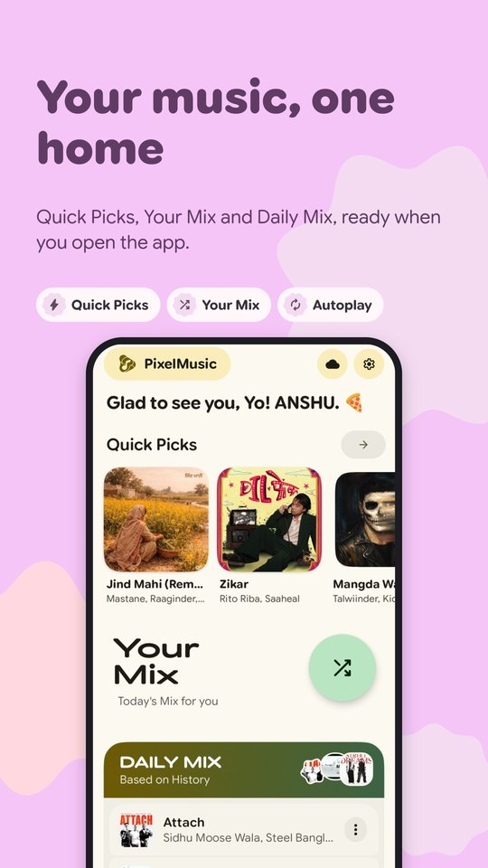
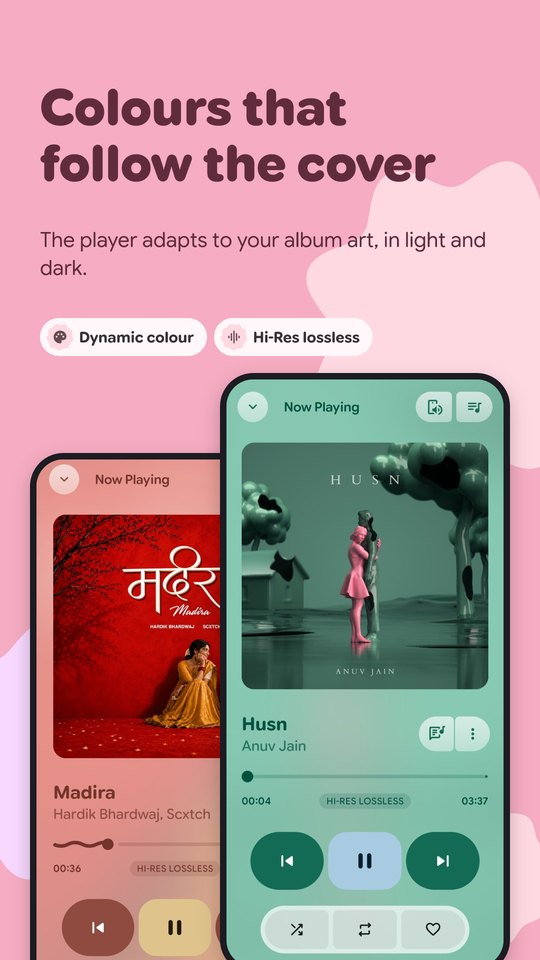

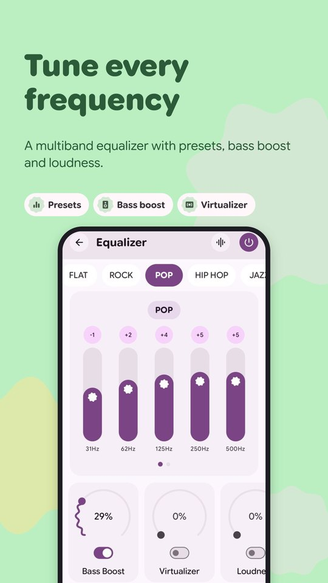
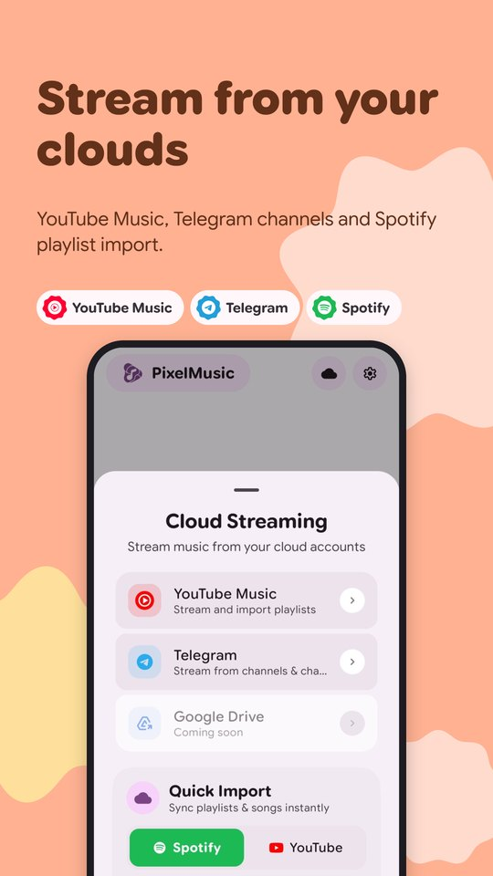
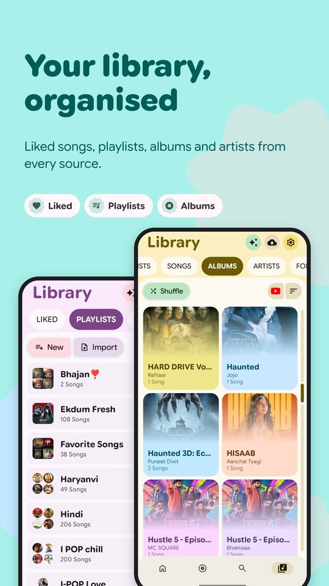

</div>

<h3 id="design"><picture><source media="(prefers-color-scheme: dark) and (max-width: 640px)" srcset="assets/readme/dark/hm-design.svg"><source media="(prefers-color-scheme: dark)" srcset="assets/readme/dark/h-design.svg"><source media="(max-width: 640px)" srcset="assets/readme/light/hm-design.svg"></picture></h3>

PixelMusic is built with Jetpack Compose and follows the Material 3 Expressive design system. Containers change shape as you interact with them, navigation uses a floating pill bar, and the color palette updates to match your current album artwork or your Android wallpaper.

<h3 id="features"><picture><source media="(prefers-color-scheme: dark) and (max-width: 640px)" srcset="assets/readme/dark/hm-features.svg"><source media="(prefers-color-scheme: dark)" srcset="assets/readme/dark/h-features.svg"><source media="(max-width: 640px)" srcset="assets/readme/light/hm-features.svg"></picture></h3>

<div align="center">

| | |
|:---:|:---:|
| <picture><source media="(prefers-color-scheme: dark)" srcset="assets/readme/dark/card-audio.svg">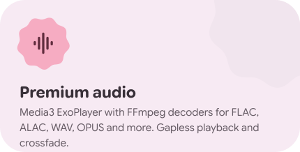</picture> | <picture><source media="(prefers-color-scheme: dark)" srcset="assets/readme/dark/card-streaming.svg">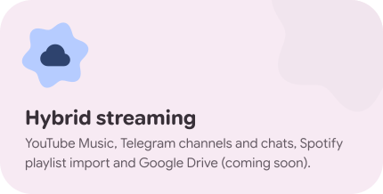</picture> |
| <picture><source media="(prefers-color-scheme: dark)" srcset="assets/readme/dark/card-lyrics.svg">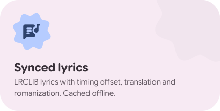</picture> | <picture><source media="(prefers-color-scheme: dark)" srcset="assets/readme/dark/card-eq.svg">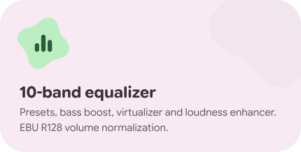</picture> |
| <picture><source media="(prefers-color-scheme: dark)" srcset="assets/readme/dark/card-ai.svg">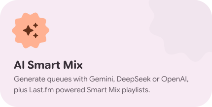</picture> | <picture><source media="(prefers-color-scheme: dark)" srcset="assets/readme/dark/card-theme.svg">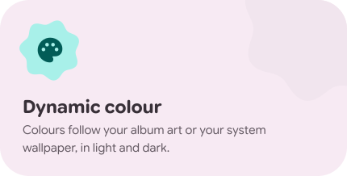</picture> |
| <picture><source media="(prefers-color-scheme: dark)" srcset="assets/readme/dark/card-share.svg">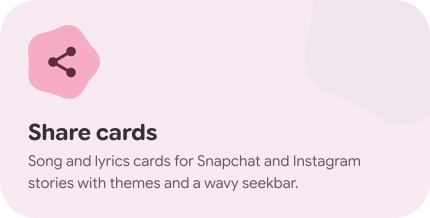</picture> | <picture><source media="(prefers-color-scheme: dark)" srcset="assets/readme/dark/card-eco.svg">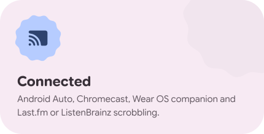</picture> |

</div>

How PixelMusic compares to other music apps

* Sources: Plays local music, YouTube Music, and Telegram audio. Google Drive support is in progress.
* Interface: Built with Material 3 Expressive. It has shape transitions and smooth spring motion.
* Colors: Extracts dynamic colors from both album covers and system wallpapers.
* Audio: Uses Media3 ExoPlayer with FFmpeg decoding and a 10 band equalizer.
* Lyrics: Loads synchronized lyrics with time sync, offline storage, and manual search.
* AI Playlists: Creates smart playlists using Gemini, DeepSeek, or OpenAI prompts.
* Ecosystem: Works with Android Auto, Chromecast, Wear OS, Last.fm, and ListenBrainz.
* License: Fully free and open source under GPL 3.0.

<h3 id="audio"><picture><source media="(prefers-color-scheme: dark) and (max-width: 640px)" srcset="assets/readme/dark/hm-audio.svg"><source media="(prefers-color-scheme: dark)" srcset="assets/readme/dark/h-audio.svg"><source media="(max-width: 640px)" srcset="assets/readme/light/hm-audio.svg"></picture></h3>

<table width="100%"><thead><tr><th align="left" width="28%">Feature</th><th align="left">Details</th></tr></thead><tbody>
<tr><td><b>Playback Engine</b></td><td>Media3 ExoPlayer with FFmpeg extension for reliable decoding across complex codecs.</td></tr>
<tr><td><b>Lossless Formats</b></td><td>FLAC · ALAC · WAV · APE (bit-perfect playback up to 24-bit/192kHz resolution).</td></tr>
<tr><td><b>Lossy Formats</b></td><td>AAC · OPUS · OGG · MP3 with high-efficiency streaming decoders.</td></tr>
<tr><td><b>Equalizer</b></td><td>10-band EQ · Bass Boost · Virtualizer · Loudness Enhancer for fine-tuned audio control.</td></tr>
<tr><td><b>Presets</b></td><td>Bass Booster · Vocal · Treble · Classical & custom user profiles.</td></tr>
<tr><td><b>Normalization</b></td><td>EBU R128 loudness normalization applied across both local and streaming tracks.</td></tr>
<tr><td><b>Crossfade & Gapless</b></td><td>0 – 15 s custom crossfade duration with true seamless gapless playback transitions.</td></tr>
</tbody></table>

<h3 id="streaming"><picture><source media="(prefers-color-scheme: dark) and (max-width: 640px)" srcset="assets/readme/dark/hm-streaming.svg"><source media="(prefers-color-scheme: dark)" srcset="assets/readme/dark/h-streaming.svg"><source media="(max-width: 640px)" srcset="assets/readme/light/hm-streaming.svg"></picture></h3>

<table width="100%"><thead><tr><th align="left" width="30%">Source</th><th align="left" width="20%">Status</th><th align="left">Capabilities & Notes</th></tr></thead><tbody>
<tr><td><b>YouTube Music</b></td><td>Available</td><td>Search, full audio playback, liked tracks & playlists via secure WebView authentication. Personal use only.</td></tr>
<tr><td><b>Telegram</b></td><td>Available</td><td>Stream audio from connected public channels, private group chats, and your saved messages.</td></tr>
<tr><td><b>Spotify / YouTube Import</b></td><td>Available</td><td>One-tap quick import of public playlists directly by sharing or pasting playlist URLs.</td></tr>
<tr><td><b>Google Drive</b></td><td>In Progress</td><td>Personal cloud storage integration for streaming directly from private Drive directories.</td></tr>
<tr><td><b>Deezer Artwork</b></td><td>Available</td><td>Automated high-resolution artist and album cover metadata fetching.</td></tr>
</tbody></table>

<h3 id="lyrics"><picture><source media="(prefers-color-scheme: dark) and (max-width: 640px)" srcset="assets/readme/dark/hm-lyrics.svg"><source media="(prefers-color-scheme: dark)" srcset="assets/readme/dark/h-lyrics.svg"><source media="(max-width: 640px)" srcset="assets/readme/light/hm-lyrics.svg"></picture></h3>

<table width="100%"><thead><tr><th align="left" width="28%">Feature</th><th align="left">Details</th></tr></thead><tbody>
<tr><td><b>Source</b></td><td>LRCLIB synced lyrics engine with automatic fallback and local Room database caching.</td></tr>
<tr><td><b>Timing Offset</b></td><td>Millisecond-level real-time offset adjustment controls when lyrics are out of sync with audio.</td></tr>
<tr><td><b>Language Tools</b></td><td>Instant live translation and phonetic romanization for Japanese (Romaji), Chinese (Pinyin), and Korean.</td></tr>
<tr><td><b>Story Cards</b></td><td>Create custom lyrics quote cards with frosted glass styling for Instagram & Snapchat stories.</td></tr>
</tbody></table>

<h3 id="ai"><picture><source media="(prefers-color-scheme: dark) and (max-width: 640px)" srcset="assets/readme/dark/hm-ai.svg"><source media="(prefers-color-scheme: dark)" srcset="assets/readme/dark/h-ai.svg"><source media="(max-width: 640px)" srcset="assets/readme/light/hm-ai.svg"></picture></h3>

<table width="100%"><thead><tr><th align="left" width="28%">Feature</th><th align="left">Details</th></tr></thead><tbody>
<tr><td><b>AI Music Assistant</b></td><td>Generates tailored listening queues and curated tracklists based on natural language prompts.</td></tr>
<tr><td><b>Supported Models</b></td><td>Gemini · DeepSeek · OpenAI · Custom OpenAI-compatible proxy endpoints.</td></tr>
<tr><td><b>Smart Mix</b></td><td>Last.fm-powered smart playlist recommendation engine with 8 distinct curated modes.</td></tr>
<tr><td><b>Retention Rules</b></td><td>Custom expiration settings: keep mixes for 24 hours, 7 days, 30 days, or permanently.</td></tr>
<tr><td><b>Overwrite Mode</b></td><td>Easily refresh and overwrite existing AI queues in place without cluttering your library.</td></tr>
<tr><td><b>Autoplay</b></td><td>Continuously queues similar tracks when your playlist ends so the music never stops.</td></tr>
</tbody></table>

<h3 id="customize"><picture><source media="(prefers-color-scheme: dark) and (max-width: 640px)" srcset="assets/readme/dark/hm-customize.svg"><source media="(prefers-color-scheme: dark)" srcset="assets/readme/dark/h-customize.svg"><source media="(max-width: 640px)" srcset="assets/readme/light/hm-customize.svg"></picture></h3>

<table width="100%"><thead><tr><th align="left" width="28%">Feature</th><th align="left">Details</th></tr></thead><tbody>
<tr><td><b>Dynamic Color</b></td><td>Extracts harmonious dynamic palettes from album artwork or Android 12+ system wallpapers.</td></tr>
<tr><td><b>Share Cards</b></td><td>Export beautiful song and lyrics story cards with wavy seekbars and frosted glass effects.</td></tr>
<tr><td><b>Landing Tab</b></td><td>Set your preferred startup screen: Home, Explore, Search, or Library.</td></tr>
<tr><td><b>Theme Modes</b></td><td>Full support for Light, Dark, Pure Black (AMOLED), and System Default themes.</td></tr>
</tbody></table>

<h3 id="ecosystem"><picture><source media="(prefers-color-scheme: dark) and (max-width: 640px)" srcset="assets/readme/dark/hm-ecosystem.svg"><source media="(prefers-color-scheme: dark)" srcset="assets/readme/dark/h-ecosystem.svg"><source media="(max-width: 640px)" srcset="assets/readme/light/hm-ecosystem.svg"></picture></h3>

<table width="100%"><thead><tr><th align="left" width="28%">Platform</th><th align="left">Integration</th></tr></thead><tbody>
<tr><td><b>Android Auto</b></td><td>Fully compliant Media3 <code>MediaLibraryService</code> interface for automotive touchscreens and steering controls.</td></tr>
<tr><td><b>Chromecast</b></td><td>Stream audio seamlessly to Smart TVs, Google Cast dongles, and Nest smart speakers.</td></tr>
<tr><td><b>Wear OS</b></td><td>Standalone companion app supporting wrist playback controls, queue management, and offline sync.</td></tr>
<tr><td><b>Scrobbling</b></td><td>Automatic background track scrobbling to Last.fm and ListenBrainz profiles.</td></tr>
</tbody></table>

<h3 id="performance"><picture><source media="(prefers-color-scheme: dark) and (max-width: 640px)" srcset="assets/readme/dark/hm-performance.svg"><source media="(prefers-color-scheme: dark)" srcset="assets/readme/dark/h-performance.svg"><source media="(max-width: 640px)" srcset="assets/readme/light/hm-performance.svg"></picture></h3>

<table width="100%"><thead><tr><th align="left" width="28%">Optimization</th><th align="left">Details</th></tr></thead><tbody>
<tr><td><b>Phased Loading</b></td><td>Heavy Explore queries and playlist sync tasks are deferred to background coroutines for instant screen opens.</td></tr>
<tr><td><b>MIUI / HyperOS Fix</b></td><td>Lockscreen artwork displayed reliably via a dedicated custom content provider.</td></tr>
<tr><td><b>Thread Safety & R8</b></td><td>Concurrent database queries with tuned R8 ProGuard rules for fast startup and minimal memory footprint.</td></tr>
</tbody></table>

<h3 id="stack"><picture><source media="(prefers-color-scheme: dark) and (max-width: 640px)" srcset="assets/readme/dark/hm-stack.svg"><source media="(prefers-color-scheme: dark)" srcset="assets/readme/dark/h-stack.svg"><source media="(max-width: 640px)" srcset="assets/readme/light/hm-stack.svg"></picture></h3>

<div align="center">

<picture><source media="(prefers-color-scheme: dark)" srcset="assets/readme/dark/stack.svg">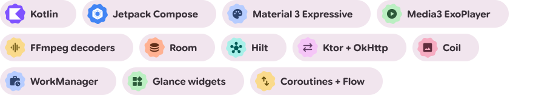</picture>

</div>

<br>

<table width="100%"><thead><tr><th align="left" width="25%">Layer</th><th align="left" width="35%">Library / Tool</th><th align="left">Role</th></tr></thead><tbody>
<tr><td><b>Language</b></td><td>Kotlin 2.x · JVM 21</td><td>Modern, expressive 100% Kotlin codebase.</td></tr>
<tr><td><b>UI Framework</b></td><td>Jetpack Compose · Compose BOM</td><td>Modern declarative user interface with hardware-accelerated rendering.</td></tr>
<tr><td><b>Design System</b></td><td>Material 3 Expressive</td><td>Fluid adaptive components, dynamic coloring, and spring motion.</td></tr>
<tr><td><b>Media Player</b></td><td>Media3 ExoPlayer · Session · UI</td><td>Robust foreground/background playback and platform media controls.</td></tr>
<tr><td><b>Audio Processing</b></td><td>FFmpeg extension · EBU R128</td><td>Advanced lossless codec decoding and cross-source volume normalization.</td></tr>
<tr><td><b>Database</b></td><td>Room + KSP</td><td>Thread-safe SQLite storage for library index, playback history, and lyrics cache.</td></tr>
<tr><td><b>Dependency Injection</b></td><td>Dagger Hilt</td><td>Modular dependency injection for Android lifecycle components and WorkManager.</td></tr>
<tr><td><b>Networking</b></td><td>Ktor Client · OkHttp</td><td>High-performance HTTP networking with Brotli compression support.</td></tr>
<tr><td><b>Serialization</b></td><td>Retrofit · Gson · Kotlinx Serialization</td><td>Efficient JSON parsing for third-party streaming API responses.</td></tr>
<tr><td><b>Image Loading</b></td><td>Coil 3</td><td>Asynchronous Compose image loader with multi-tier memory and disk LRU caching.</td></tr>
<tr><td><b>Async Processing</b></td><td>Coroutines · StateFlow · SharedFlow</td><td>Reactive state management and non-blocking background concurrency.</td></tr>
<tr><td><b>Background Tasks</b></td><td>WorkManager</td><td>Scheduled library indexing, playlist updates, and cache cleanup.</td></tr>
<tr><td><b>Metadata Extraction</b></td><td>JAudioTagger</td><td>High-performance local ID3, Vorbis, and FLAC tag extraction.</td></tr>
<tr><td><b>Widgets</b></td><td>Glance</td><td>Material 3 interactive home screen widgets.</td></tr>
<tr><td><b>Min SDK</b></td><td>Android 11 (API 30)</td><td>Wide device compatibility covering modern Android devices.</td></tr>
<tr><td><b>Target SDK</b></td><td>Android 37</td><td>Compiled against the latest Android platform release.</td></tr>
</tbody></table>

<h3 id="start"><picture><source media="(prefers-color-scheme: dark) and (max-width: 640px)" srcset="assets/readme/dark/hm-start.svg"><source media="(prefers-color-scheme: dark)" srcset="assets/readme/dark/h-start.svg"><source media="(max-width: 640px)" srcset="assets/readme/light/hm-start.svg"></picture></h3>

**Requirements**

| Requirement | Version |
|---|---|
| Android Studio | Ladybug (2024.2.1) or newer |
| Android SDK | 34+ (target 37) |
| JDK | 21 |

**Build**

```bash
git clone https://github.com/ianshulyadav/PixelMusicApp.git
cd PixelMusicApp
./gradlew :app:assembleDebug
```

> Add your Gemini or DeepSeek keys to `local.properties` to enable the AI playlist features.

<h3 id="faq"><picture><source media="(prefers-color-scheme: dark) and (max-width: 640px)" srcset="assets/readme/dark/hm-faq.svg"><source media="(prefers-color-scheme: dark)" srcset="assets/readme/dark/h-faq.svg"><source media="(max-width: 640px)" srcset="assets/readme/light/hm-faq.svg"></picture></h3>

**What is PixelMusic?** PixelMusic (Pixel Music) is a free, open-source Android music player for local files, YouTube Music, and Telegram audio.

**Does PixelMusic have ads?** No. The app is 100% ad-free with zero subscriptions.

**Which Android versions work?** Android 11 (API 30) and above.

**Can it play FLAC, ALAC, AAC, OPUS and Dolby files?** Yes. See the [audio formats section](#audio). Dolby playback depends on device decoders.

**Can I stream YouTube Music and Telegram?** Yes. Sign in to YouTube Music via WebView or connect Telegram, then stream and sync directly.

**Where do the lyrics come from?** Synced lyrics are fetched from LRCLIB with offset adjustment, live translation and romanization.

**Where can I get help?** Join the [Telegram channel](https://t.me/pixelmusicapp) or open an [issue](https://github.com/ianshulyadav/PixelMusicApp/issues).

<h3 id="support"><picture><source media="(prefers-color-scheme: dark) and (max-width: 640px)" srcset="assets/readme/dark/hm-support.svg"><source media="(prefers-color-scheme: dark)" srcset="assets/readme/dark/h-support.svg"><source media="(max-width: 640px)" srcset="assets/readme/light/hm-support.svg"></picture></h3>

PixelMusic is free and ad-free. If it makes your day better, you can help with development and testing through a small donation. Using the app, sharing it, and sending feedback helps just as much!

<div align="center">

<a href="https://ko-fi.com/H2K222J1ME" target="_blank"><picture><source media="(prefers-color-scheme: dark)" srcset="assets/readme/dark/btn-kofi.svg"></picture></a>
<a href="upi://pay?pa=anshulyadavv@fam&pn=PixelMusic&cu=INR"><picture><source media="(prefers-color-scheme: dark)" srcset="assets/readme/dark/btn-upi.svg"></picture></a>

<br><br>

| Method | Link / Details |
|---|---|
| **Ko-fi** | [ko-fi.com/H2K222J1ME](https://ko-fi.com/H2K222J1ME) |
| **UPI ID** | `anshulyadavv@fam` |
| **UPI Intent** | [upi://pay?pa=anshulyadavv@fam&pn=PixelMusic&cu=INR](upi://pay?pa=anshulyadavv@fam&pn=PixelMusic&cu=INR) |

</div>

<h3 id="legal"><picture><source media="(prefers-color-scheme: dark) and (max-width: 640px)" srcset="assets/readme/dark/hm-legal.svg"><source media="(prefers-color-scheme: dark)" srcset="assets/readme/dark/h-legal.svg"><source media="(max-width: 640px)" srcset="assets/readme/light/hm-legal.svg"></picture></h3>

PixelMusic is an independent, community-driven audio player. It is not associated with Google LLC, YouTube Music, Deezer, Telegram, Snapchat, Last.fm, ListenBrainz or their parent companies. It does not host or store copyrighted music, and users are responsible for complying with applicable laws and platform terms. All third-party integrations are unofficial unless stated otherwise.

<h3 id="license"><picture><source media="(prefers-color-scheme: dark) and (max-width: 640px)" srcset="assets/readme/dark/hm-license.svg"><source media="(prefers-color-scheme: dark)" srcset="assets/readme/dark/h-license.svg"><source media="(max-width: 640px)" srcset="assets/readme/light/hm-license.svg"></picture></h3>

PixelMusic is licensed under the **GNU General Public License v3.0**. See [`LICENSE`](LICENSE). Portions are based on PixelPlayerOSS by Theo Vilardo and Duhan Yağmur Delikkulak.

<h3 id="credits"><picture><source media="(prefers-color-scheme: dark) and (max-width: 640px)" srcset="assets/readme/dark/hm-credits.svg"><source media="(prefers-color-scheme: dark)" srcset="assets/readme/dark/h-credits.svg"><source media="(max-width: 640px)" srcset="assets/readme/light/hm-credits.svg"></picture></h3>

PixelMusic is an independent, unofficial fork of [PixelPlayerOSS](https://github.com/PixelPlayerHQ/PixelPlayerOSS) by [Theo Vilardo](https://github.com/theovilardo) and Duhan Yağmur Delikkulak. Not affiliated with or endorsed by the upstream project. Upstream notice kept in [`LICENSE`](LICENSE) and [`PROVENANCE.md`](PROVENANCE.md).

<sub>Search terms: Pixel Music, PixelMusic, Android music player, ad-free music player, open-source music player, Hi-Res lossless player, FLAC player, ALAC player, YouTube Music client, Telegram music player, LRCLIB lyrics, Material 3 Expressive.</sub>
